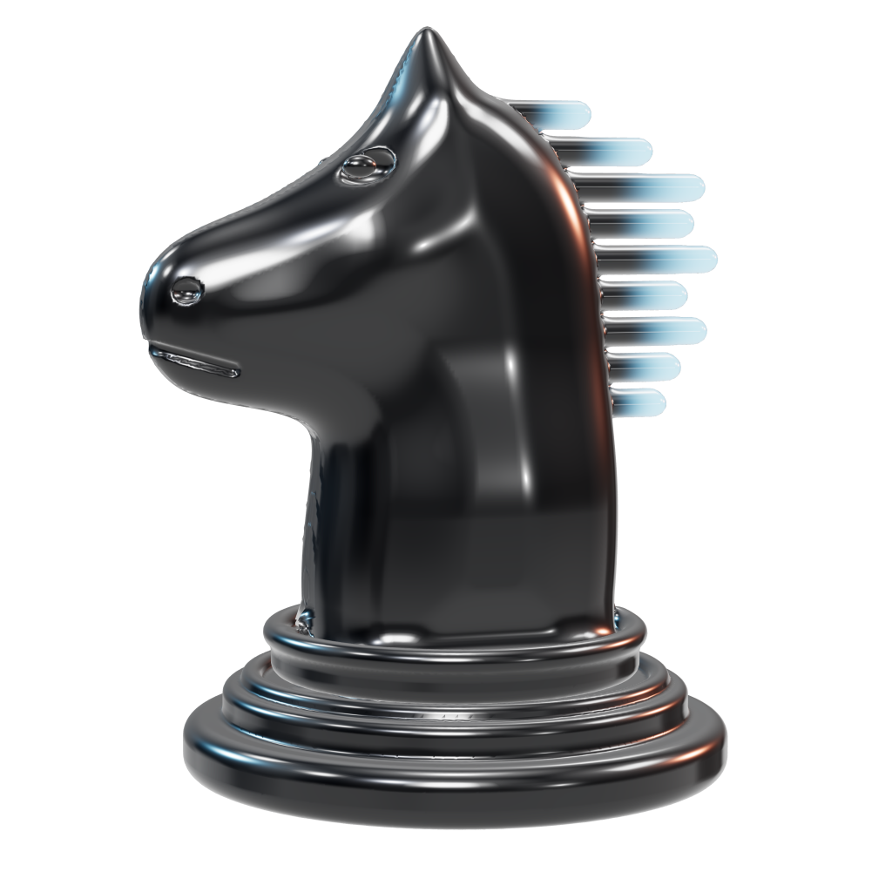

<p align="center"></p>

# Chess Beats

Turn any chess game into music. Every move plays a note; captures, checks, castling, promotions and checkmate get their own sounds.

## Using it

1. Double-click `index.html` for the landing page, or `play.html` to go straight to the player (any modern browser; needs internet the first time to load chess.js and Tone.js from a CDN).
2. Click **All games** to browse the library, or **Load a game** to paste a PGN, upload a `.pgn` file, or type a chess.com username and pick one of that player's last 25 standard games. The landing page's **Load a game** button and the library's **Load your own game** offer the same, and open the game in the player.
3. Press **▶**. Change tempo, key, scale and layers any time, even while it plays.

Keyboard: `Space` play/pause · `→` step forward (with sound) · `←` step back (silent) · `Home` / `End`.
Click any move in the move list to jump there.

## Game library

`games.html` shows **1,003 games** as a grid, in four categories:

| Category | Collections |
|---|---|
| **World champions** (721) | 35 games each from Steinitz, Lasker, Capablanca, Alekhine, Euwe, Botvinnik, Smyslov, Petrosian, Spassky, Karpov, Kasparov, Kramnik, Anand, Carlsen, Ding and Gukesh, plus Fischer's *My 60 Memorable Games* (60) and *The Life and Games of Mikhail Tal* (101) |
| **Legends** (180) | 15 each: Morphy, Anderssen, Zukertort, Pillsbury, Tarrasch, Rubinstein, Marshall, Nimzowitsch, Réti, Keres, Bronstein, Korchnoi |
| **Women** (100) | 20 each: Gaprindashvili, Chiburdanidze, Xie Jun, Hou Yifan, Judit Polgar |
| **Classics** (2) | The built-in games |

The PGN Mentor files hold over 60,000 games, mostly blitz and online for modern players, so `tools/fetch-pgnmentor.js` picks a subset. It keeps classical games only, then favours the player's wins, world-championship matches and major events (AVRO, Linares, Wijk aan Zee, Olympiads and so on) and livelier games. Picks are spread across each player's career, with at most 3 games against the same opponent outside title matches, and no game appears in two collections.

- **Each card's board shows the game's most intense moment** (where tension peaks), with that move tinted. The orange sparkline is the game's tension from start to finish, so you can choose a game by the shape of its music.
- **▶ Preview** plays the 8 moves around the peak at the game's own key and tempo, and steps the card's board along with the notes.
- **Filter and sort** by category, player, result, character (tactical / balanced / positional) and decade. You can also search players, events, openings and years, and sort by date, drama or length. Filters are kept in the URL.
- **Album mode:** in the player, **← / →** step through the current collection in date order. Tick **Auto-advance** to roll into the next game when one ends. After picking a chess.com game, the arrows and Auto-advance walk that player's list instead, newest to oldest.

## How moves become music

| Chess | Sound |
|---|---|
| Destination file a–h | Note in the pentatonic scale (a–e = degrees 1–5, f–h continue an octave up) |
| Destination rank 1–8 | Octave: ranks 1–2 low … ranks 7–8 high |
| White / Black | Bright triangle synth (left) / dark FM synth (right) |
| Pawn → Queen | 16th note, soft → half note, loud (knight/bishop 8th, rook/king quarter) |
| Capture | Louder note + snare |
| Check | Cymbal |
| Castling | Three-note chord |
| Promotion | Rising run |
| Checkmate | Big final hit (low chord + kick + cymbal) |
| Game ends without mate | Soft closing chord |

## How the whole game shapes the music

Before playing, the app analyses the entire game (material, tension and phase after every move). Four layers use that, and each has a checkbox so you can switch it off and hear what it adds:

| Layer | What you hear |
|---|---|
| **Motion** | Knights leap (grace note on the start square, then the landing square). Rooks, bishops and queens moving 3+ squares glide up or down to their destination. Long moves ring longer. |
| **Harmony** | A soft background pad. Its chord follows the material balance: level = open sus2 chord, White ahead = bright major chord, Black ahead = minor chord, a sudden swing of 3+ points = a tense chord. |
| **Groove** | A beat that follows tension (captures, checks and how many captures are available). Calm = silence → hi-hats → kick + bass → full beat with snare. |
| **Phase** | Opening: sparse and dry. Middlegame: everything on. Endgame: slower, with echo and more reverb. |

**Auto key.** With Key and Scale on *Auto*, each game picks its own: tactical games (lots of captures and checks) go minor, positional games major, and the key comes from the opening moves, so games with the same opening share a key. Every game (and every preview in the library) starts at 200 BPM, except chess.com imports: bullet games start at 250 and blitz at 225. Pick any key, scale or tempo to override.

**Timeline.** The strip under the board shows the shape of the game: background colour = phase, orange area = tension, white line = material (up = White ahead, down = Black ahead), red ticks = captures, yellow ticks = checks. Click it to jump to that point.

Try the two built-in games back to back: the **Immortal Game** (1851) is a storm of captures and checks ending in mate, while **Karpov vs Unzicker** (1974) is a slow positional squeeze that ends in resignation. You'll hear the difference.

## Files

**Pages**
- `index.html`, `landing.css`, `landing.js`: the landing page (the front page). It silently plays the Immortal Game to animate itself, and its mixing desk plays each channel's sound when you click or hover it.
- `play.html`, `style.css`, `app.js`: the player: board, PGN loading, move list, playback
- `games.html`, `games.css`, `games-page.js`: the game library page

**Music (pure logic, tested in Node)**
- `music.js`: move → notes mapping, including the motion melody
- `analysis.js`: whole-game pass: material, tension, phase, profile and auto key/tempo
- `arrangement.js`: pad chord, groove and effects for each move
- `pgn.js`: PGN → moves, positions and analysis, shared by the player, the library page and the build
- `chesscom.js`: a chess.com player's most recent standard games, from chess.com's public API (no key)
- `load-dialog.js`, `load-dialog.css`: the "Load a game" dialog (paste, upload or chess.com), shared by the landing page, the player and the library

**Sound and visuals**
- `audio.js`: Tone.js instruments, plus the iPhone fixes (plays with the silent switch on, resumes after the screen locks)
- `background.js`: animated glass background (WebGL) on the landing page and the player. Its lit edges turn from cyan to amber as tension rises. The shader is adapted from GlassFold in [GradFlow](https://gradflow.meerbahadin.dev).
- `knight3d.js`: the 3D knight itself (a sculpted distance field turned into a mesh), shared by the logo renderer and the landing page
- `landing-knight.js`: the landing page's live knight: grab it to spin it, flick it, and it springs back home
- `pieces.js`: the Cburnett chess pieces as SVG, so they look the same on every device
- `miniboard.js`: the small board and tension-line previews on library cards and in the chess.com picker
- `sling.js`: the player's playback buttons: tap them, or pull one sideways and let go
- `brand/`: the logo, favicons and iPhone home-screen icon (**generated** by `npm run build:logo`)

**Game data**
- `games.js`: built-in classics (source for the Classics collection)
- `library.js`: **generated** game library (do not edit)
- `data/pgn/`: the Fischer and Tal books from [brianerdelyi/ChessPGN](https://github.com/brianerdelyi/ChessPGN) (CC0), and `pgnmentor-selected.pgn` (**generated**: the games picked from PGN Mentor)

**Tools and tests**
- `tools/collections.js`: the list of collections, categories and quotas
- `tools/fetch-pgnmentor.js`, `tools/pgn-select.js`, `tools/zip.js`: download PGN Mentor player files and pick the games
- `tools/pgn-normalize.js`, `tools/build-library.js`: clean the PGNs and build `library.js`
- `tools/logo/knight.html`, `tools/logo/render.mjs`: frame the 3D knight from `knight3d.js` and render `brand/` in headless Chrome
- `test/`: the tests run by `npm test`

**For contributors**
- `CLAUDE.md`: the project's rules and how to deploy; `PLAN.md`: open work

## Tests (optional, for developers)

```
npm install
npm test
```

This checks the note mapping, the game analysis and the arrangement, the PGN clean-up, the chess.com fetch (against a fake API), and that every library game replays legally. The app itself needs no install or build step.

After changing `data/pgn/`, `games.js` or `tools/collections.js`, regenerate the library:

```
npm run fetch:pgnmentor   # only when the PGN Mentor picks should change: downloads ~30 MB into data/cache/ (gitignored), about 5 minutes
npm run build:library     # works offline from the committed files
```

## Credits

- **Fischer and Tal books:** game scores from [brianerdelyi/ChessPGN](https://github.com/brianerdelyi/ChessPGN), released under CC0. The books are Fischer, *My 60 Memorable Games* (Simon & Schuster, 1969) and Tal, *The Life and Games of Mikhail Tal* (RHM, 1976).
- **Everything else:** the player files at [PGN Mentor](https://www.pgnmentor.com/files.html).
- **Chess pieces:** the Cburnett set by Colin M.L. Burnett, [CC BY-SA 3.0](https://creativecommons.org/licenses/by-sa/3.0/), taken from [lichess-org/lila](https://github.com/lichess-org/lila/tree/master/public/piece/cburnett) and bundled in `pieces.js`.

Only moves and game headers are used, with no annotations. chessentials.com was also considered, but it blocks automated downloads, so none of its files are used.
